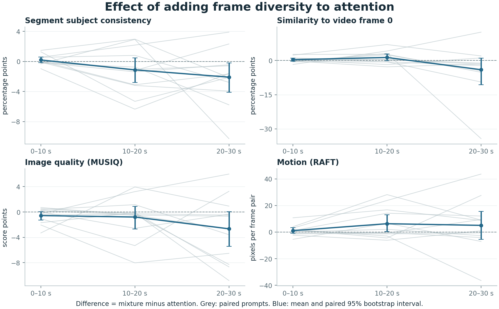
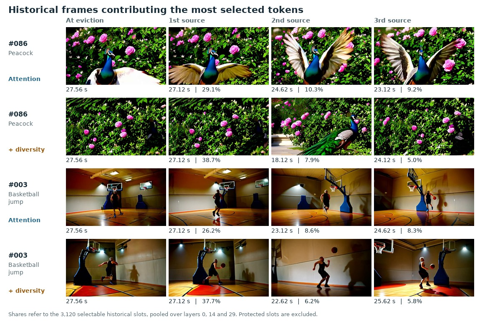

# Causal Forcing 长视频缓存的分段诊断

2026 年 11 月 24 日，单张 RTX 4090 完成 12 条运动提示词、24 段 30.56 秒视频的配对实验。**加入帧多样性后，最后 10 秒的主体一致性从 87.19 降到 85.11，12 对中 10 对下降。缓存里最稳定的变化，是同一帧拿走了更多历史名额。** 换入帧的画质与换出帧相近，这批结果对“多样性优先保留崩坏帧”这一解释支持有限。[配对明细](output/paired_segments.csv) · [统计汇总](output/summary.json)

## 变化从哪一段开始

下表给出 12 条提示词的均值。差值均为融合组减注意力组，从未取整的逐对分数计算。主体一致性和全片首帧相似度的变化以百分点计，MUSIQ 以画质分计，光流以每对采样帧的像素位移计。

| 时间段 | 主体一致性，注意力 → 融合 | 配对差［95% 区间］ | 全片首帧相似度差 | MUSIQ 画质差 | RAFT 光流差 |
|---|---:|---:|---:|---:|---:|
| 0–10 秒 | 86.06 → 86.26 | +0.20［−0.15，+0.58］ | +0.37 | −0.56 | +1.07 |
| 10–20 秒 | 88.19 → 87.07 | −1.11［−2.78，+0.49］ | +1.34 | −0.79 | +6.29 |
| 20–30 秒 | 87.19 → 85.11 | **−2.08［−4.11，−0.19］** | −4.02 | −2.65 | +5.05 |

最后一段相对于第一段，主体一致性的组间差又下降了 **2.29 个百分点**，配对区间为［−4.24，−0.44］。末段逐对差值的中位数为 −1.89。去掉下降最大的孔雀样例，其余 11 对平均仍下降 1.34 个百分点。末段画质差的区间为［−5.40，+0.06］，光流差的区间为［−5.48，+15.52］。VBench 二值动态程度在两组、三个时段都为 12/12，区分这些运动提示词时，连续光流比通过率提供了更多信息。[各指标的区间与提示词计数](output/summary.json)



## 缓存实际留下了什么

下面的比较固定在**同一次压缩、同一池候选 token**。两种打分各选 3,120 个名额，统计被换入和被换出的 token。有效来源帧数同时考虑覆盖了几帧及名额是否均匀；例如全部名额均分给 8 帧时，该数为 8。

| 时段 | 被替换的可选名额 | 有效来源帧数，注意力 → 融合 | 占名额最多的一帧所占比例变化 | 换入帧相对换出帧的来源时间 |
|---|---:|---:|---:|---:|
| 0–10 秒 | 27.42% | 5.59 → 4.39 | +7.05 个百分点 | 早 1.63 秒 |
| 10–20 秒 | 22.68% | 7.79 → 6.43 | +6.47 个百分点 | 早 2.86 秒 |
| 20–30 秒 | 22.63% | **7.44 → 5.75** | **+7.80 个百分点** | 早 1.33 秒 |

**来源集中在 12 条提示词的末段全部出现。** 有效来源帧数的平均变化为 −1.69［−1.89，−1.48］。按记录的第 0、14、29 层分别计算，变化为 −0.67、−2.61、−1.80。帧级分数由同一帧的候选 token 共享，因此提高一帧的分数可以让它的多个空间位置同时胜出。开头 10 个潜在帧的名额在两组中始终受保护。集中现象发生在其余可竞争的历史名额中。[逐段缓存统计](output/retention_segments.csv) · [分层统计](output/retention_by_layer.csv)

**换入帧没有表现出稳定的低画质或远离首帧的倾向。** 末段换入减换出的 MUSIQ 差为 −0.12［−1.00，+0.64］，与全片首帧的相似度差为 +1.32 个百分点［−0.39，+4.01］。同时落在两项指标最低四分位的来源帧，占比差为 +1.95 个百分点［−1.52，+6.10］。这些帧级代理量仍可能漏掉局部形变，来源集中与后续一致性下降之间的因果关系也需要单独干预。[同一候选集上的筛选记录](output/traces/)

## 回看最后 10 秒

按末段主体一致性差值取下降最大和上升最大的两对。两例中多样性都使名额更集中，输出表现却有两个方向。

- **孔雀，#086**。提示词要求孔雀最后开屏，尾羽占满画面。融合组末段主体一致性从 89.55 降到 79.29。23 和 28 秒的画面里，原版孔雀仍清楚地出现在画面中央附近，融合版的大部分画面被花丛占据，孔雀移到右缘。此时融合版的 MUSIQ 反而高出 **5.98 分**。27.56 秒做缓存筛选时，融合组把 **38.7%** 的可选名额给了约 27.12 秒的来源帧，这一帧中花丛已经占据大部分画面。这个例子说明，清晰的背景与主体偏离预定构图可以同时发生。[孔雀末段并排视频](output/figures/086-late.mp4) · [实际被保留的来源帧](output/figures/retained-frames.jpg)
- **篮球，#003**。融合组末段主体一致性从 85.21 升到 89.11。两边的运动员都还在画面中。23–28 秒，原版拉出可见多个篮架的球场，融合版更多时间沿侧墙取景。同在 27.56 秒筛选，约 27.12 秒的来源帧在两条实际轨迹中分别占 26.2% 和 37.7%。段内主体一致性提高的同时，与全片首帧的相似度仍下降 1.61 个百分点，两项指标回答的是不同问题。[篮球末段并排视频](output/figures/003-late.mp4) · [按秒查看保留来源](output/figures/retention-map.png)



两对视频另有六个固定时刻的并排截图，可对照主体从画面中的哪个位置进入或离开。[3、8、13、18、23、28 秒的画面](output/figures/storyboard.jpg)

**下一组最值得验证的是限制单个来源帧能拿多少名额。** 一个可直接复核的对照是保留相同的融合分数和 3,120 个名额，用纯注意力在同一候选池内分给单帧的最高名额数作为上限，按融合分数填满预算。先检查这个限制是否恢复历史帧覆盖，再用新种子检验末段一致性与运动能否保住。它直接干预本次观察到的集中现象。当前结果不足以把与首帧不相似的候选一律判作漂移。

## 实际开销与配对核验

生成用时 41 分 13 秒，独立评测及进程交接用时 7 分 24 秒，合计 **48 分 37 秒，约 0.81 个 4090 卡时**。单条生成平均耗时为注意力组 99.41 秒、融合组 100.32 秒。生成期间每 2 秒采样一次，整卡显存峰值为 **15.85 GiB**，24 段全部完成。每段均有 510 次跨层缓存压缩，每次保留预算均为 24,960；12 对的初始噪声抽样一致，首次淘汰前的 21 个潜在帧逐元素相同。最终取得 24 段原视频、72 份逐视频逐指标结果、36 行逐提示词配对分段结果。[生成与配对记录](output/meta/) · [显存采样](output/generation-gpu.csv) · [原视频](output/videos/) · [逐帧和逐段评分](output/scores/)

## 实验设计

从 Causal Forcing 作者用于 Dynamic Degree 的 100 条提示词中预选 12 条，涵盖人物全身动作、动物运动和户外运镜。每条提示词固定一份初始噪声，种子为 24000 加提示词原始编号。相同权重在两种缓存策略下各生成一次，交替运行顺序，共 24 段视频。人工选择的 12 条提示词用于探查机制，每条只有一个种子。[提示词全文与种子](prompts.json) · [作者确认提示词来源](https://github.com/thu-ml/Causal-Forcing/issues/25#issuecomment-4203786215)

生成使用 Causal Forcing 的官方 chunkwise 权重、Deep Forcing 的官方推理管线、Wan2.1-1.3B、BF16、每块 3 个潜在帧、4 步去噪、batch size 1。每条生成 123 个潜在帧，解码为 489 帧，832 × 480，16 fps。两组都在 VAE 解码前释放去噪缓存，在 CPU 完成像素后处理，并在生成进程退出后运行评测。[Causal Forcing 权重](https://huggingface.co/zhuhz22/Causal-Forcing/tree/main/chunkwise) · [生成入口](generate.py)

- **注意力组**使用 Deep Forcing 原生的历史 token 排名、保护窗口和最大重复选择次数。每层每次压缩后保留 24,960 个 token。其中 15,600 个属于固定的开头 10 个潜在帧，6,240 个属于最近 4 帧，3,120 个历史名额参与排序。每个潜在帧对应 1,560 个空间位置。[Deep Forcing 原版选择器](https://github.com/cvlab-kaist/DeepForcing/blob/ea9961aa4bd5b554daeecdcf59e37c495fba9df6/wan/modules/causal_model.py#L495-L525)
- **融合组**将候选 token 的标准化注意力得分和其来源帧的标准化多样性得分各占一半。多样性按 Focused Forcing 式 9–11，从每个空间位置的历史平均 key 出发，计算负余弦相似度，再按来源帧求平均。Deep Forcing 会淘汰单个 token，因此只在仍存活的同位置 key 上求均值；各注意力头的标准化得分取均值后，交给 Deep Forcing 共享的 token 选择器。结果适用于这项移植；Focused Forcing 完整算法还包含按头分配预算与按查询选帧。[Focused Forcing §3.3](https://arxiv.org/html/2605.18346#S3.SS3) · [实际计分代码](cache_probe.py)

融合组直接读取 Deep Forcing 缓存中经过旋转位置编码的 key。同一旧帧可能只剩少数空间位置，因此得分还可能受时间位置和存活区域影响。第一次淘汰始于第 21 个潜在帧，对应输出约 5.06 秒；第一个 10 秒区间包含一段两组共享的生成历史。

## 指标与判读

每段视频只取前 480 帧，连续切为三个互不重叠的 160 帧区间；末尾 9 帧保留在原视频。三段均在原始编码视频上评估。各指标先求每条提示词、每一段的配对差，再在 12 条提示词上等权求均值。误差区间按提示词成对有放回抽样 20,000 次，取均值的 2.5% 和 97.5% 分位。区间描述本批提示词的敏感性；增加种子或更换提示词的影响仍待验证。[分段评测](evaluate_segments.py) · [配对统计](analyze.py)

| 指标 | 在每个 10 秒区间测什么 |
|---|---|
| VBench 主体一致性 | 用 DINO ViT-B/16 提取整帧特征，将与段首及与上一帧的余弦相似度等权平均。各段重新设参考帧，分数按百分制报告。 |
| 全片首帧相似度 | 每帧与同一条视频第 0 帧的 DINO 相似度。它能反映跨段外观变化，也受视角、构图与背景变化影响。 |
| MUSIQ 画质 | 使用 SPAQ 权重和 VBench 的长边 512 预处理，在区间内逐帧打分，再取平均，按 0–100 报告。 |
| RAFT 运动 | 8 fps 采样，每段 79 对图像，每对跑 20 次 RAFT 迭代。记录最大 5% 像素的平均光流幅度，并按 VBench 阈值报告有足够运动的片段数。运镜也会贡献光流。 |

[VBench 主体一致性](https://github.com/Vchitect/VBench/blob/1039fe66d7aa2f4b214003ca2d35f5011c48bfee/vbench/subject_consistency.py) · [VBench 画质](https://github.com/Vchitect/VBench/blob/1039fe66d7aa2f4b214003ca2d35f5011c48bfee/vbench/imaging_quality.py) · [VBench 动态程度](https://github.com/Vchitect/VBench/blob/1039fe66d7aa2f4b214003ca2d35f5011c48bfee/vbench/dynamic_degree.py)

缓存记录覆盖第 0、14、29 层的每次压缩。每个 token 单独记录原始潜在帧号和空间位置，以便追溯重排前的来源。对融合轨迹，在每次压缩前的完全相同候选上，另算一遍纯注意力会选中哪些 token。两者相交可得到实际替换比例。将换入、换出 token 对应到本条视频的解码帧，再比较这些来源帧的首帧相似度与画质；同帧内换位时，两个 token 的帧级分数相同。这个指标描述筛选偏好，单独用它无法确定某个 token 导致之后的画面变化。为衡量保留名额是否集中，还计算有效来源帧数 $1/\sum_f p_f^2$，其中 $p_f$ 是某个来源帧占 3,120 个可选名额的比例。[缓存记录实现](cache_probe.py) · [逐层逐段记录](output/retention_by_layer.csv)

另外按每次压缩的候选来源帧，分别计算画质和首帧相似度的最低四分位。统计换入与换出 token 来自这两个指标同时偏低的帧的比例差，用来检查均值是否掩盖了低分样本。低分是相对于该次的候选集定义的，画面是否出现形变仍需回看视频。

## 复现入口

生成环境为 PyTorch 2.8.0+cu128、torchvision 0.23.0、FlashAttention 2.8.3、diffusers 0.31.0、transformers 4.49.0。评测沿用同一版 PyTorch，配合 VBench v0.1.5、PyIQA 0.1.13 和 decord 0.6.0。DINO 使用官方 ViT-B/16 预训练权重，MUSIQ 使用 SPAQ 权重，RAFT 使用 VBench 的 `raft-things.pth`。[DINO 源码版本](https://github.com/facebookresearch/dino/tree/7c446df5b9f45747937fb0d72314eb9f7b66930a) · [MUSIQ 权重](https://huggingface.co/chaofengc/IQA-PyTorch-Weights/blob/c753dca46d76714c9bb7849eadc2bd5854716320/musiq_spaq_ckpt-358bb6af.pth) · [评测日志](assessment.log)

在本项目的 4090 环境中，将本目录的脚本放入 `~/projects/causal-forcing-repro/runs/` 下的独立运行目录。生成脚本使用同一项目中的原始源码归档、既有官方权重及 `.venv-gen` 环境。评测使用同项目的 `vendor/VBench`、`vbench-cache` 和本次记录的 DINO、MUSIQ 权重。结果写入运行目录的 `output/`，各臂的初始噪声抽样、共享前缀检查、缓存预算及耗时保存在 `output/meta/`。[原始 Deep Forcing 源码归档](../results/deep30/source.tar.gz) · [源码修改](deepforcing.patch) · [依赖及权重准备](fetch_assets.sh)

```bash
bash fetch_assets.sh
bash generate.sh
bash evaluate.sh
bash summarize.sh
```
